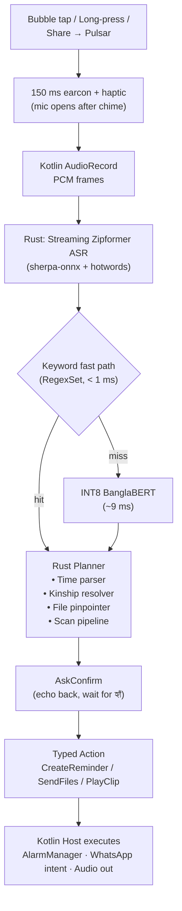

# Project Context: Pulsar — Offline Bangla Voice Agent (`CONTEXT.md`)

> Companion doc: [`SUGGESTIONS.md`](SUGGESTIONS.md) holds the detailed MVP build plan, decision log, and weekly checklist. This file holds the **vision, architecture, and constraints**.

---

## 1. Vision & Positioning

**Pulsar is an ultra-fast, privacy-first, offline-first Bangla voice agent for elderly, non-tech-savvy, and busy ("lazy") users in Bangladesh.**
*(একজন নির্ভরযোগ্য ব্যক্তিগত সহকারী)*

Pulsar is not a chatbot and not a voice dialer. It removes the daily tasks people currently **ask a family member for help with** or that cost **many taps**.

### Target Users
| User | Pain |
|---|---|
| **Elderly** | Weak memory, weak eyesight, can't attach files in WhatsApp. |
| **Non-tech-savvy** | Menus, typing, and multi-step flows are barriers. |
| **Busy / lazy** | Wants one sentence instead of ten taps. |

### Feature Filter
A feature belongs in Pulsar only if it is used **daily/weekly**, replaces **5+ taps or a call to family**, and works for **all three user groups**.

---

## 2. MVP Scope

| # | Feature | Example |
|---|---|---|
| **1** | **Smart Reminders** — medicine + tasks, one-time and recurring | *"প্রতিদিন সকাল ৮টা আর রাত ১০টায় প্রেশারের ওষুধ মনে করিয়ে দিও"* |
| **2** | **Scan & Send** — gallery photos → clean PDF → family on WhatsApp | *"এগুলো স্ক্যান করে ছেলেকে PDF করে পাঠাও"* |

### Language & Accent
* **MVP:** Standard Bangla (প্রমিত) + **Rajshahi** accent for understanding. Replies in standard Bangla.
* **Phase 2:** 8 divisional accent clusters (Dhaka, Chattogram, Rajshahi, Khulna, Barishal, Sylhet, Rangpur, Mymensingh) via an accent-robust deep-learning model — generalize per cluster rather than collecting data for every local accent.

### Deferred (v2+)
bKash/Nagad scam guard · accent-matched talk-back · OCR / prescription reading · Gemini fact-checking · kinship calling · contact saving from SMS · always-on wake word.

---

## 3. Architecture — Rust Harness + Thin Hosts

Pulsar is built as a **harness**, not a monolithic app. A Rust core owns all intelligence; platform hosts only capture input and execute typed actions.



### Core Principles
1. **Core never touches OS APIs.** Input: PCM + share intents. Output: `Action` enum.
2. **One brain, many shells.** Android host for production; desktop CLI host (wav in, mock storage) for fast testing.
3. **Python is for training only.** Kaggle notebooks, hotword tuning, ASR fine-tuning. Nothing Python ships on device.
4. **100% offline** for both MVP features. No personal data — voice, contacts, images, reminders — ever leaves the device.

### Rust Workspace
```
crates/
  core/    # pipeline, planner, Action enum, Host trait
  asr/     # sherpa-onnx streaming wrapper
  nlu/     # fast path + BanglaBERT (ort + tokenizers)
  remind/  # Bangla time parser, repeat rules, SQLite
  scan/    # edge detect, warp, enhance, PDF
  kin/     # kinship graph + fuzzy contact index
  voice/   # clip bank + slot concatenation
  cli/     # desktop test host
  ffi/     # uniffi → Kotlin (cargo-ndk, arm64-v8a)
```

### Android Host Responsibilities (Kotlin, thin)
* Mic capture (`AudioRecord`) → push PCM to Rust.
* Share target (`ACTION_SEND_MULTIPLE`) → pass image URIs to Rust.
* Floating agent bubble (`SYSTEM_ALERT_WINDOW`).
* Reminder scheduling (`AlarmManager.setExactAndAllowWhileIdle`), full-screen alert, reschedule on boot.
* WhatsApp handoff (`ACTION_SEND` + `com.whatsapp` + `jid`, fallback to WhatsApp picker).
* Audio playback of clips.

---

## 4. Feature Flows

### 4.1 Smart Reminders
```
"কাল বিকাল ৪টায় বিল দিতে মনে করিয়ে দিও"
  → ASR → REMIND_CREATE
  → time parser: {when: tomorrow 16:00, repeat: none, task: <user audio>}
  → "কাল বিকাল ৪টায় মনে করাব, ঠিক আছে?" → "হ্যাঁ"
  → SQLite + AlarmManager
  → fires: full-screen alert + voice (user's own recorded task)
  → "হয়ে গেছে" = done | "১০ মিনিট পরে" = snooze
  → medicine missed twice → optional family notification
```
* Rule-based Bangla time parser (আজ / কাল = tomorrow / পরশু, সকাল / দুপুর / বিকাল / সন্ধ্যা / রাত, সাড়ে / পৌনে / সোয়া, প্রতিদিন, X দিন ধরে, দিনে X বার, X ঘণ্টা পরে).
* Voice management: list, cancel, done, snooze.

### 4.2 Scan & Send
```
Gallery: select images → Share → Pulsar
  → bubble appears, mic open
  → "এগুলো স্ক্যান করে ছেলেকে PDF করে পাঠাও" → SCAN_SEND_PDF
  → per image: edge detect → perspective warp → deskew → enhance
  → merge PDF
  → kinship: ছেলে → contact (ask if multiple sons)
  → "৩টা পাতা বড় ছেলের হোয়াটসঅ্যাপে পাঠাব?" → "হ্যাঁ"
  → WhatsApp chat opens with PDF attached → user taps send
```
* Variants: send as images (no PDF), named / numbered non-kin recipient, no selection ("আজকের তোলা ছবিগুলো") via file pinpointer.
* **Constraint:** Android sandboxing prevents reading another app's gallery selection → Share sheet is the entry point; the bubble is the agent's presence.

---

## 5. Activation

* **MVP: push-to-talk only** — floating bubble tap, long-press, or Share → Pulsar.
* **Wake response:** 150 ms earcon + single haptic. ASR stream opens **after** the chime to avoid transcribing Pulsar's own audio. No spoken greeting.

> [!IMPORTANT]
> **Why no always-on wake word in MVP:** third-party apps can't use the hardware DSP (`AlwaysOnHotwordDetector`) that Google Assistant uses. A screen-off mic `PARTIAL_WAKE_LOCK` drains **15–25% battery/day** on budget phones, and MIUI/HyperOS/Transsion kill background mic services after ~10 minutes. Revisit later as screen-on/charging-only.

---

## 6. Voice Output

Realistic standard Bangla, near-zero latency, offline:

| Tier | Share of replies | Method | Latency |
|---|---|---|---|
| **Fixed phrases** | ~80% | Pre-rendered with premium TTS (ElevenLabs / Sarvam / Smallest.ai) at build time, bundled | ~0 ms |
| **Slots** | ~15% | Pre-rendered numbers, times, kinship words concatenated in Rust; reminder task = user's own recording | ~0–5 ms |
| **Dynamic** | ~5% | Cloud TTS when online; local Bangla VITS fallback | 100–400 ms |

* Spoken replies **< 3 seconds**.
* Paid TTS plan for commercial rights. No training own models on third-party TTS output.

---

## 7. Privacy & Safety

* **Zero personal data egress.** Voice, contacts, images, PDFs, reminders stay on device.
* **Echo-confirm every action** before executing. Never blindly send files.
* **Locked phone:** reminders may fire and be acknowledged; sending files requires unlock (`BiometricPrompt`).
* **Recipient check:** sending to a number not in contacts/kinship graph requires explicit confirmation with the number spoken and shown.
* **Downstream-only updates:** hotword dictionaries and model updates over HTTPS, signed (ECDSA); unsigned payloads rejected.

### MVP Permissions
`RECORD_AUDIO`, `FOREGROUND_SERVICE_MICROPHONE`, `READ_CONTACTS`, `READ_MEDIA_IMAGES`, `SYSTEM_ALERT_WINDOW`, `SCHEDULE_EXACT_ALARM`, `USE_FULL_SCREEN_INTENT`, `POST_NOTIFICATIONS`, `RECEIVE_BOOT_COMPLETED`, `VIBRATE`, `USE_BIOMETRIC`.
**Not requested:** `READ_SMS`, `CAMERA`, `CALL_PHONE`, `BIND_ACCESSIBILITY_SERVICE`.

---

## 8. Performance Budget

### Targets (MVP, on 3 GB RAM budget phone)
| Metric | Target |
|---|---|
| End-of-speech → reply audio start | **< 550 ms** (endpoint silence dominates; tune it) |
| Final ASR decode | 20–50 ms |
| Intent (fast path / BanglaBERT) | < 1 ms / ~9 ms |
| Time parse, kin resolve | < 1 ms |
| Scan + PDF, 3 pages | < 500 ms |
| Resident RAM | < 250 MB |

### Verified So Far (Python prototype, desktop)
| Metric | Result |
|---|---|
| INT8 BanglaBERT size / latency | 13.69 MB / 9.07 ms CPU |
| Kinship & file search | 0.08 ms |
| ASR residual streaming latency | ~20 ms |
| End-to-end clip benchmark | ~200 ms |
| Real user audio accuracy | 4/4 clips (100%) |
| Resident RAM | ~140 MB |

These must be re-verified in the Rust core on a physical budget phone.

---

## 9. Assets Carried Forward

* **ASR:** `sherpa-onnx-streaming-zipformer-bn-vosk-2026-02-09` + 76 daily hotwords (`bangladesh_daily_hotwords.txt`). Extend with time, medicine, and kinship words.
* **Intent model:** INT8 BanglaBERT — retrain on MVP intents: `REMIND_CREATE`, `REMIND_LIST`, `REMIND_CANCEL`, `REMIND_DONE`, `REMIND_SNOOZE`, `SCAN_SEND_PDF`, `SEND_IMAGES`, `CONFIRM_YES`, `CONFIRM_NO`, `UNKNOWN`.
* **Kinship graph + contact resolver** (`agent_core/contact_resolver.py`, `kinship_graph.json`) → port to `kin` crate, including prosthetic-vowel prefix stripping (`আবসের → বস`) + Levenshtein ≤ 2.
* **File pinpointer** (`agent_core/file_pinpointer.py`) → port to Rust.
* **Kaggle pipeline** (`build_kaggle_notebooks.py`, `kaggle_kernel/`) → reuse for Rajshahi ASR fine-tuning and intent retraining.

---

## 10. Roadmap

- [x] **Phase 0 — Python prototype:** ASR + hotwords, BanglaBERT intent router, kinship resolver, file pinpointer, Kaggle notebooks.
- [ ] **Phase 1 — MVP (8 weeks, see `SUGGESTIONS.md` §10):** Rust harness, Rajshahi accent ASR, Smart Reminders, Scan & Send, pre-rendered voice, field test with 5–10 users.
- [ ] **Phase 2 — Expansion:** scam guard, 8-division accent ASR, accent-matched talk-back.
- [ ] **Phase 3 — Intelligence:** offline OCR + prescription → auto medicine reminders, fact-check bridge, screen-on wake word.
